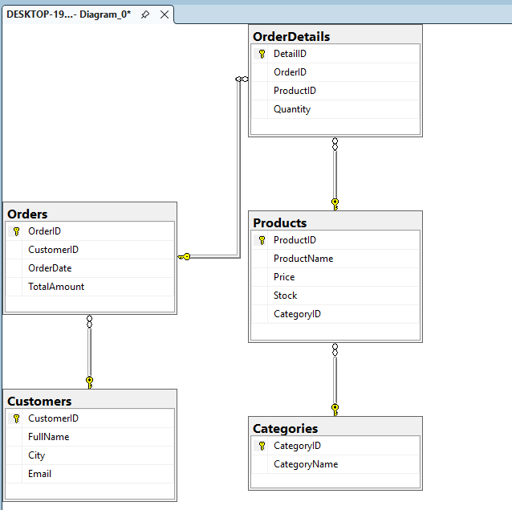

# NovaStore E-Ticaret Veri Yönetim Sistemi

SQL eğitimi sonunda hazırladığım proje. NovaStore adında hayali bir e-ticaret sitesi için ürünlerin, müşterilerin ve siparişlerin tutulduğu ilişkisel bir veri tabanı tasarladım, örnek verilerle doldurdum ve yönetim için rapor sorguları yazdım.

**Kullanılanlar:** Microsoft SQL Server 2022 Express, SQL Server Management Studio

## Veri tabanı yapısı

| Tablo | Açıklama |
|---|---|
| `Categories` | Ürün kategorileri |
| `Products` | Ürünler; her ürün bir kategoriye bağlı |
| `Customers` | Müşteriler; e-posta adresi benzersiz |
| `Orders` | Siparişler; her sipariş bir müşteriye bağlı |
| `OrderDetails` | Siparişlerle ürünleri bağlayan ara tablo |

## İçerik

- **Bölüm 1 – DDL:** `NovaStoreDB` veri tabanı ve 5 tablo (primary key, foreign key, `IDENTITY`, `DEFAULT`, `UNIQUE`, `NOT NULL`)
- **Bölüm 2 – DML:** 5 kategori, 12 ürün, 6 müşteri, 10 sipariş ve 17 sipariş detayı
- **Bölüm 3 – Sorgular:**
  1. Stoku 20'den az olan ürünler
  2. Müşterilerin sipariş tarihleri ve tutarları (`INNER JOIN`)
  3. Bir müşterinin aldığı ürünler ve kategorileri (5 tablo `JOIN`)
  4. Kategori başına ürün sayısı (`LEFT JOIN`, `GROUP BY`, `COUNT`)
  5. Müşteri başına toplam ciro (`SUM`, `GROUP BY`, `ORDER BY`)
  6. Siparişlerin üzerinden geçen gün sayısı (`DATEDIFF`, `GETDATE`)
- **Bölüm 4:** `vw_SiparisOzet` view'ı ve `BACKUP DATABASE` ile yedekleme

## Dosyalar

| Dosya | İçerik |
|---|---|
| `TahaCihanker_NovaStore_Proje.sql` | Tüm SQL kodları (tablolar, veri girişi, sorgular, view, yedekleme) |
| `TahaCihanker_NovaStore_Proje.docx` | Proje raporu: kodlar, sorgu sonuçlarının ekran görüntüleri ve açıklamalar |
| `TahaCihanker_NovaStore_Proje.png` | Tabloların ilişki diyagramı |

## Çalıştırma

`TahaCihanker_NovaStore_Proje.sql` dosyasını SSMS'te açıp çalıştırmak yeterli. Yedekleme adımı için `C:\Yedek\` klasörünün önceden oluşturulmuş olması gerekiyor.
